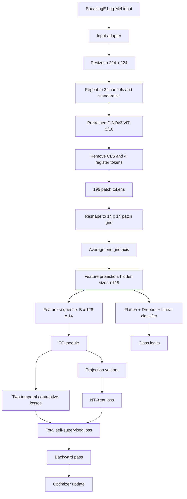
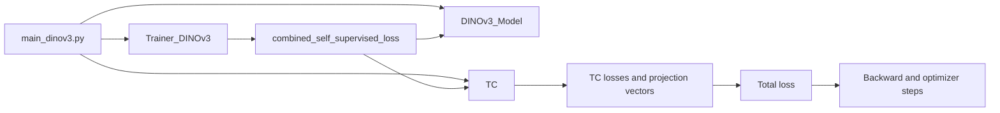
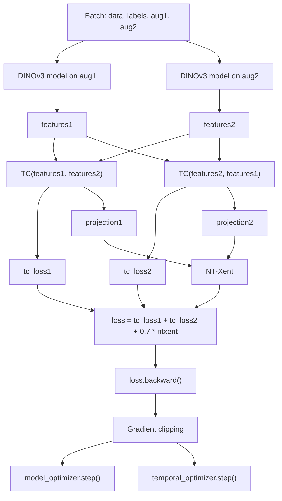

# DINOv3 + TS-TCC 

> **A practical guide to the architecture, training pipeline, DINOv3 integration, loss functions, and parameter updates.**

This project integrates a pretrained **DINOv3 ViT-S/16** backbone into the **TS-TCC** time-series contrastive learning pipeline. Speech input is represented as Log-Mel features, converted to an image-like tensor, encoded by DINOv3, and projected into a short feature sequence for the Temporal Contrasting (TC) module.

The repository supports three training modes: **self-supervised**, **supervised**, and **linear evaluation** (`train_linear`).

---

## Table of Contents

- [1. Project Overview](#1-project-overview)
- [2. System Overview](#2-system-overview)
- [3. Repository Files](#3-repository-files)
- [4. Environment](#4-environment)
- [5. Setup](#5-setup)
- [6. Run and Verify](#6-run-and-verify)
- [7. DINOv3 Integration Details](#7-dinov3-integration-details)
- [8. Loss Functions and Parameter Updates](#8-loss-functions-and-parameter-updates)
- [9. Training Modes](#9-training-modes)
- [10. Checkpoints and Outputs](#10-checkpoints-and-outputs)
- [11. Troubleshooting](#11-troubleshooting)
- [12. Limitations and Future Work](#12-limitations-and-future-work)
- [13. References](#13-references)

---

## 1. Project Overview

### 1.1 What does the project do?

The original TS-TCC pipeline uses a CNN-based encoder to extract features from time-series inputs. In this version, the encoder is replaced by a pretrained DINOv3 Vision Transformer, with an adapter that converts Log-Mel features into the input format expected by DINOv3.

The resulting feature sequence is passed to the existing TC module for self-supervised temporal learning. A classification head is also provided for labeled downstream tasks.

### 1.2 Main components

| Component | Role |
|---|---|
| SpeechOcean762 data loader | Loads data, labels, and augmented views |
| Log-Mel adapter | Converts `(B, 64, T)` features into three-channel images |
| DINOv3 ViT-S/16 | Extracts pretrained visual representations |
| Feature projection | Maps the DINOv3 hidden dimension to the TS-TCC feature dimension |
| TC module | Calculates temporal contrastive loss and projection vectors |
| NT-Xent loss | Encourages matching views to have similar representations |
| Classifier | Produces class logits for supervised evaluation |
| Trainer | Runs optimization, validation, and checkpoint saving |

### 1.3 Design goals

- Reuse pretrained DINOv3 features.
- Keep the temporal contrastive module from TS-TCC.
- Use two augmented views for self-supervised training.
- Support supervised classification and linear evaluation.
- Keep the loss calculation and optimizer behavior easy to inspect.

> **Scope note:** This README describes the supplied code files. It does not claim that DINOv3 is a speech-native model or that this integration necessarily outperforms the original TS-TCC baseline.

---

## 2. System Overview

### 2.1 Overall data flow



The classifier branch is used for supervised training and evaluation. In self-supervised mode, the loss is calculated from the TC outputs and projection vectors, not directly from the classifier logits.

### 2.2 Expected tensor shapes

The following shapes describe the default configuration used by `DINOv3_Model`. `B` is the batch size and `T` is the number of input frames.

| Stage | Tensor shape | Explanation |
|---|---|---|
| Log-Mel input | `(B, 64, T)` | 64 Mel bins and `T` frames |
| Add channel dimension | `(B, 1, 64, T)` | Single-channel image-like input |
| Resize and repeat channels | `(B, 3, 224, 224)` | Input accepted by the selected vision backbone |
| DINOv3 hidden states | Usually `(B, 201, 384)` | CLS + 4 register tokens + 196 patch tokens |
| Remove special tokens | `(B, 196, 384)` | Patch tokens only |
| Patch grid | `(B, 14, 14, 384)` | 14 by 14 grid |
| Average one grid axis | `(B, 14, 384)` | Short sequence of patch features |
| Feature projection | `(B, 14, 128)` | Linear + LayerNorm + GELU |
| TC feature input | `(B, 128, 14)` | Channel-first format used by TC |
| Classifier output | `(B, num_classes)` | Raw class logits |
| TC projection output | `(B, 32)` under the default configuration | Used by NT-Xent |

The DINOv3 token count is checked at runtime. If the selected model returns a different number of patch or special tokens, the code raises an error rather than silently using an incorrect slice.

---

## 3. Repository Files

The supplied code package contains the following important files. Paths may need to be adjusted to match the directory layout in the full repository.

| File | Responsibility |
|---|---|
| `main_dinov3.py` | DINOv3 entry point, arguments, data loading, model and optimizer setup, smoke test, training, and final test evaluation |
| `dinov3_model.py` | DINOv3 backbone, image adapter, patch processing, feature projection, and classifier |
| `trainer_dinov3.py` | Self-supervised loss, evaluation, training loop, gradient clipping, scheduler, and checkpoint saving |
| `TC.py` | Temporal Contrasting module, prediction layers, sequence Transformer, and projection head |
| `loss.py` | Original TS-TCC NT-Xent implementation used by the CNN trainer |
| `main.py` | Original TS-TCC entry point |
| `trainer.py` | Original TS-TCC training and evaluation logic |
| `model.py` | Original CNN-based TS-TCC encoder and classifier |
| `smoke_test_dinov3.py` | Checks data loading, model output shapes, and TC forward calls |
| `test_dinov3.py` | Checks whether the pretrained DINOv3 model can be loaded and run |
| `requirements_before_dinov3.txt` | A dependency snapshot from before the DINOv3 integration; review it before using it as an installation file |

### Key execution path

| Step | File/function | What happens |
|---|---|---|
| 1 | `main_dinov3.py` → `main()` | Reads command-line arguments and creates the experiment directory |
| 2 | `data_generator(...)` | Loads training, validation, and test data |
| 3 | `DINOv3_Model(configs)` | Creates the backbone, feature projection, and classifier |
| 4 | `TC(configs, device)` | Creates the temporal contrastive module |
| 5 | `combined_self_supervised_loss(...)` | Calculates the two TC losses and NT-Xent |
| 6 | `Trainer_DINOv3(...)` | Runs the training and validation loop |
| 7 | `evaluate(...)` | Calculates validation or test metrics for the selected mode |
| 8 | `save_checkpoint(...)` | Saves model, TC, optimizer, epoch, and validation information |

---

## 4. Environment

### 4.1 Main requirements

The supplied code uses:

- Python
- PyTorch
- Hugging Face Transformers
- NumPy
- The project's TS-TCC data loader and configuration files

The exact compatible versions depend on the environment in which the code is run. The file `requirements_before_dinov3.txt` is explicitly a pre-integration snapshot, so it should not be treated as a verified complete dependency list for DINOv3.

### 4.2 Check Python and PyTorch

```bash
python --version
python -c "import torch; print('PyTorch:', torch.__version__)"
python -c "import torch; print('CUDA available:', torch.cuda.is_available())"
python -c "import transformers; print('Transformers:', transformers.__version__)"
```

To display the GPU name:

```bash
python -c "import torch; print(torch.cuda.get_device_name(0) if torch.cuda.is_available() else 'CPU mode')"
```

### 4.3 Hardware

A CUDA-compatible NVIDIA GPU is recommended for training. CPU mode can be useful for debugging, but DINOv3 inference and training may be slow.

---

## 5. Setup

### 5.1 Clone the repository

```bash
git clone https://github.com/tranvanh10205-ctrl/CD_TH2.git
cd CD_TH2
```

### 5.2 Create a virtual environment

**Windows PowerShell**

```powershell
python -m venv .venv
.\.venv\Scripts\Activate.ps1
```

**Linux or macOS**

```bash
python3 -m venv .venv
source .venv/bin/activate
```

### 5.3 Install dependencies

If the repository has a maintained `requirements.txt` file, use it:

```bash
pip install -r requirements.txt
```

If it does not, install the dependencies required by the current source code and the original TS-TCC data pipeline. Avoid installing `requirements_before_dinov3.txt` without checking its encoding and version compatibility first.

### 5.4 Prepare the dataset

The DINOv3 entry point defaults to:

```text
./data/SpeechOcean762
```

The data loader is called from `main_dinov3.py`:

```python
train_dl, valid_dl, test_dl = data_generator(
    args.data_path, configs, args.training_mode
)
```

Make sure the dataset directory matches the data loader's expected structure. Each batch is expected to provide four values:

```text
data, labels, aug1, aug2
```

- `data`: original input used for supervised training/evaluation.
- `labels`: class labels.
- `aug1`: first augmented view.
- `aug2`: second augmented view.

The precise file naming and preprocessing requirements are defined by the data loader and configuration, not by `main_dinov3.py` alone.

---

## 6. Run and Verify

### 6.1 Test DINOv3 loading

Run the standalone backbone test from the directory containing `test_dinov3.py`:

```bash
python test_dinov3.py
```

This test loads the configured pretrained model and sends a dummy tensor with shape `(1, 3, 224, 224)` through it.

### 6.2 Test the full DINOv3 + TC forward path

Run:

```bash
python smoke_test_dinov3.py
```

This test checks that the data loader returns batches, the DINOv3 model returns logits and features, and the TC module returns losses and projection vectors.

Expected shapes in the default configuration include:

```text
DINOv3 features: (B, 128, 14)
DINOv3 logits:   (B, num_classes)
TC projections:  (B, 32)
```

The actual batch size depends on the configuration and the last batch.

### 6.3 Start self-supervised training

```bash
python main_dinov3.py --training_mode self_supervised --device cuda
```

### 6.4 Start supervised training

```bash
python main_dinov3.py --training_mode supervised --device cuda
```

### 6.5 Run linear evaluation

Linear evaluation loads a self-supervised checkpoint from the matching experiment and run directory. First run self-supervised training, then use the same seed and directory settings:

```bash
python main_dinov3.py --training_mode train_linear --device cuda
```

If the checkpoint cannot be found, check `--logs_save_dir`, `--experiment_description`, `--run_description`, and `--seed`. They must match the self-supervised run.

### 6.6 Useful command-line arguments

| Argument | Default | Purpose |
|---|---|---|
| `--training_mode` | `self_supervised` | `self_supervised`, `supervised`, or `train_linear` |
| `--seed` | `0` | Random seed |
| `--device` | `cuda` | Compute device, such as `cuda` or `cpu` |
| `--data_path` | `./data/SpeechOcean762` | Dataset directory |
| `--logs_save_dir` | `experiments_logs/SpeechOcean762_DINOv3_TS-TCC` | Root directory for experiment logs and checkpoints |
| `--experiment_description` | `Exp1` | Experiment folder name |
| `--run_description` | `DINOv3` | Run folder name |

For a CPU smoke test, use:

```bash
python main_dinov3.py --training_mode self_supervised --device cpu
```

Full CPU training may be slow.

---

## 7. DINOv3 Integration Details

This section identifies where DINOv3 is loaded, how its outputs are adapted, and where it is connected to TS-TCC.

### 7.1 Where is DINOv3 loaded?

**File:** `dinov3_model.py`  
**Class:** `DINOv3_Model`  
**Location:** `DINOv3_Model.__init__()`

The backbone is created with:

```python
self.backbone = AutoModel.from_pretrained(model_id)
```

The default model ID is:

```text
facebook/dinov3-vits16-pretrain-lvd1689m
```

The hidden size is read from the model configuration when available. For ViT-S/16, it is expected to be 384.

### 7.2 Where is the backbone frozen?

In `dinov3_model.py`, the configuration field `dinov3_freeze_backbone` controls whether the pretrained backbone is frozen:

```python
if self.freeze_backbone:
    for p in self.backbone.parameters():
        p.requires_grad = False
```

The forward pass also uses `torch.no_grad()` when the backbone is frozen. The model's `train()` method keeps the frozen backbone in evaluation mode.

| Setting | Effect |
|---|---|
| `dinov3_freeze_backbone = True` | DINOv3 weights are not updated |
| `dinov3_freeze_backbone = False` | Gradients can pass through DINOv3 and its parameters can be updated if included in the optimizer |

With the default frozen backbone, the feature projection and classifier remain trainable unless a training mode freezes them separately.

### 7.3 How is Log-Mel input converted?

**File:** `dinov3_model.py`  
**Function:** `_to_rgb_images()`

The input is expected to have shape `(B, mel_bins, frames)`. The function:

1. Checks that the input is three-dimensional.
2. Adds a single channel.
3. Resizes the tensor to `224 x 224` using bilinear interpolation.
4. Repeats the channel three times.
5. Standardizes each sample using its mean and standard deviation.

The resulting tensor has shape `(B, 3, 224, 224)`.

This adapter is required because the selected DINOv3 backbone accepts image tensors. It does not imply that the input becomes a natural image.

### 7.4 How are patch tokens extracted?

**File:** `dinov3_model.py`  
**Function:** `forward()`

The backbone is called here:

```python
outputs = self.backbone(pixel_values=images)
tokens = outputs.last_hidden_state
```

The code then removes the CLS token and four register tokens:

```python
patch_tokens = tokens[:, 1 + 4:, :]
```

For the expected default input, 196 patch tokens remain. The code checks the token count before reshaping.

| Operation | Expected shape |
|---|---|
| DINOv3 hidden states | `(B, 201, 384)` |
| Remove 1 CLS + 4 register tokens | `(B, 196, 384)` |
| Reshape to patch grid | `(B, 14, 14, 384)` |
| Average one grid axis | `(B, 14, 384)` |
| Feature projection | `(B, 14, 128)` |
| Transpose for TC | `(B, 128, 14)` |

The special-token count is specific to the selected model implementation. If a different DINOv3 variant is used, verify its token layout before reusing the same slice.

### 7.5 Feature projection and classification

The feature projection is defined in `DINOv3_Model.__init__()`:

```python
self.feature_projection = nn.Sequential(
    nn.Linear(hidden_size, self.feature_channels),
    nn.LayerNorm(self.feature_channels),
    nn.GELU(),
)
```

This maps the DINOv3 hidden dimension to `configs.final_out_channels`, which is 128 in the expected configuration.

The classifier is also defined in `dinov3_model.py`:

```python
self.classifier = nn.Linear(
    self.feature_channels * self.grid_size,
    int(configs.num_classes)
)
```

In `forward()`, the projected features are flattened, passed through dropout, and mapped to class logits. The model returns:

```python
return logits, features
```

where `features` has shape `(B, 128, 14)` under the default configuration.

### 7.6 Where is DINOv3 connected to TS-TCC?

**File:** `main_dinov3.py`

The model and TC module are initialized separately:

```python
model = DINOv3_Model(configs).to(device)
temporal_model = TC(configs, device).to(device)
```

**File:** `trainer_dinov3.py`

During self-supervised training, the trainer calls `combined_self_supervised_loss(...)`. That function runs the DINOv3 model on both augmented views and sends the resulting feature tensors to the TC module.



### 7.7 What is kept from the original TS-TCC implementation?

The integration reuses the TC module from `TC.py`. It retains the temporal prediction mechanism, sequence Transformer, projection head, and the temporal contrastive objective returned by `TC.forward()`.

The main architectural change is the feature extractor and the adapter required to convert Log-Mel input into DINOv3 features. The self-supervised loss used by the DINOv3 trainer is explicitly implemented in `trainer_dinov3.py`.

---

## 8. Loss Functions and Parameter Updates

This section describes the exact loss structure used by the supplied DINOv3 trainer and distinguishes it from the supervised objective.

### 8.1 Self-supervised loss: where is it implemented?

**File:** `trainer_dinov3.py`  
**Function:** `combined_self_supervised_loss()`

The function:

1. Runs the model on `aug1` and `aug2`.
2. Normalizes the feature tensors along the channel dimension.
3. Calls the TC module in both directions.
4. Calculates NT-Xent using the two projection vectors.
5. Combines the three terms into one scalar loss.

The key implementation is equivalent to:

```python
tc_loss1, projection1 = temporal_model(features1, features2)
tc_loss2, projection2 = temporal_model(features2, features1)

ntxent = nt_xent_loss(
    projection1,
    projection2,
    temperature=configs.Context_Cont.temperature
)

loss = tc_loss1 + tc_loss2 + 0.7 * ntxent
```

### 8.2 Total self-supervised loss

The total objective is:

```text
Total Loss = TC Loss 1 + TC Loss 2 + 0.7 * NT-Xent Loss
```

In mathematical notation:

`L_total = L_TC_1 + L_TC_2 + 0.7 * L_NTXent`

This plain-text formula is intentionally used here to avoid MathJax rendering differences across Markdown viewers.

| Term | Source | Meaning | Weight |
|---|---|---|---:|
| `tc_loss1` | `TC(features1, features2)` | Temporal contrastive objective for the first ordering | 1.0 |
| `tc_loss2` | `TC(features2, features1)` | Temporal contrastive objective for the reversed ordering | 1.0 |
| `ntxent` | `nt_xent_loss(projection1, projection2, ...)` | Contrastive objective over the projection vectors | 0.7 |

The coefficient `0.7` is a fixed hyperparameter in the supplied function. It is not learned by the optimizer.

### 8.3 What does the TC module calculate?

**File:** `TC.py`  
**Class:** `TC`  
**Function:** `forward()`

The TC module receives two feature sequences in channel-first format. It transposes them to sequence-first format, selects future time steps from the second view, processes the observed prefix with `Seq_Transformer`, and uses prediction layers to score the selected future representations.

The returned values are:

```python
return nce, self.projection_head(c_t)
```

- `nce` is the temporal contrastive loss for that ordering.
- `self.projection_head(c_t)` is a projection vector used by the NT-Xent objective.

The detailed temporal objective is implemented inside `TC.forward()`. It should not be confused with the separate NT-Xent calculation.

### 8.4 How does NT-Xent work in this version?

**File:** `trainer_dinov3.py`  
**Function:** `nt_xent_loss()`

The supplied DINOv3 trainer implements NT-Xent directly. It expects two two-dimensional projection tensors with the same shape `(B, D)` and a batch size of at least two.

Its main steps are:

1. Normalize each projection vector.
2. Concatenate the two views into `2B` representations.
3. Calculate the pairwise similarity matrix.
4. Divide similarity scores by the temperature.
5. Mask self-similarity on the diagonal.
6. Set the matching view from the other augmentation as the positive target.
7. Apply cross-entropy to the similarity matrix.

After normalization, the dot product between two vectors is their cosine similarity. The temperature controls how strongly differences between similarity scores affect the contrastive objective.

### 8.5 Total loss flow



In the actual trainer, the temporal optimizer step occurs only in `self_supervised` mode. The model optimizer step occurs in all supported modes.

### 8.6 Backpropagation and parameter updates

**File:** `trainer_dinov3.py`  
**Function:** `Trainer_DINOv3()`

The core update sequence is:

```python
model_optimizer.zero_grad(set_to_none=True)
temporal_optimizer.zero_grad(set_to_none=True)

loss.backward()

torch.nn.utils.clip_grad_norm_(..., max_norm=1.0)

model_optimizer.step()
```

The temporal optimizer is stepped only during self-supervised training:

```python
if training_mode == "self_supervised":
    temporal_optimizer.step()
```

What each operation does:

| Operation | Purpose |
|---|---|
| `zero_grad(...)` | Clears gradients from the previous iteration |
| `loss.backward()` | Computes gradients of the current loss |
| `clip_grad_norm_(..., max_norm=1.0)` | Limits the combined gradient norm for the supplied parameter list |
| `model_optimizer.step()` | Updates trainable parameters registered in the model optimizer |
| `temporal_optimizer.step()` | Updates TC parameters during self-supervised training |

The optimizer can only update parameters that are included in it, have gradients, and are not frozen.

### 8.7 Which parameters are updated in each mode?

| Parameter group | `self_supervised` | `supervised` | `train_linear` |
|---|---|---|---|
| DINOv3 backbone | Frozen by default; can be trainable if configured unfrozen | Frozen by default; can be trainable if configured unfrozen | Frozen |
| Feature projection | Updated if trainable | Updated if trainable | Frozen |
| Classifier | Included in the model optimizer, but not directly trained by the contrastive loss | Updated using Cross-Entropy | Updated using Cross-Entropy |
| TC module | Updated by the temporal optimizer | No optimizer step | No optimizer step |
| NT-Xent objective | Used | Not used | Not used |
| Cross-Entropy objective | Not used | Used | Used |

Important details:

- With the default `dinov3_freeze_backbone=True`, DINOv3 parameters are frozen.
- In `train_linear`, `main_dinov3.py` freezes all model parameters and then re-enables gradients only for `model.classifier`.
- In supervised mode, the loss is Cross-Entropy on the model logits. The TC optimizer is not stepped.
- In self-supervised mode, the loss is computed from the TC losses and projections. The classifier logits do not directly contribute to the loss.

### 8.8 Supervised Cross-Entropy loss

In supervised and linear-evaluation modes, `trainer_dinov3.py` uses:

```python
criterion = nn.CrossEntropyLoss()
loss = criterion(logits, labels)
```

The objective can be written without display-math formatting as:

`L_CE = CrossEntropyLoss(logits, labels)`

PyTorch expects raw logits and integer class labels. Do not apply softmax to the logits before passing them to `nn.CrossEntropyLoss()`.

### 8.9 Did replacing CNN with DINOv3 change the loss?

The integration changes the feature extraction path from the original CNN encoder to DINOv3 plus a feature adapter. The supplied DINOv3 trainer explicitly defines the self-supervised objective as:

`L_total = L_TC_1 + L_TC_2 + 0.7 * L_NTXent`

It also uses Cross-Entropy for supervised and linear-evaluation modes.

The original `trainer.py` uses a separate `NTXentLoss` implementation imported from `loss.py`, while `trainer_dinov3.py` defines a different `nt_xent_loss()` function. Therefore, the two implementations should not be assumed to be identical in every detail merely because both are called NT-Xent. For a scientific comparison, compare the positive-pair construction, negative-pair mask, batch-size handling, temperature, and loss reduction in both implementations.

### 8.10 Important implementation checks

Before running large experiments, verify:

- The training batch size is compatible with the NT-Xent implementation.
- The TC projection shape is two-dimensional and consistent for both views.
- The configured temperature is positive.
- The DINOv3 token layout matches the `1 + 4` special-token slice.
- The selected training mode loads the intended checkpoint.
- The optimizer contains only the parameters intended to be trained.
- The supervised and self-supervised metrics are interpreted separately.

---

## 9. Training Modes

### 9.1 Mode comparison

| Mode | Main objective | Input used for loss | Parameters updated |
|---|---|---|---|
| `self_supervised` | TC losses + weighted NT-Xent | Two augmented views | Trainable model parameters and TC parameters |
| `supervised` | Cross-Entropy | Original data and labels | Trainable model parameters |
| `train_linear` | Cross-Entropy | Original data and labels | Classifier only |

### 9.2 Self-supervised mode

The model receives `aug1` and `aug2`. It learns representations through the temporal contrastive loss and NT-Xent. The classifier is not directly trained by this objective.

### 9.3 Supervised mode

The model receives the original `data` tensor. The classifier produces logits, which are compared with the ground-truth labels using Cross-Entropy.

If the DINOv3 backbone is frozen, the feature projection and classifier can still be trained.

### 9.4 Linear evaluation

The code loads the self-supervised checkpoint and freezes all model parameters, then enables gradients only for the classifier:

```python
for parameter in model.parameters():
    parameter.requires_grad = False

for parameter in model.classifier.parameters():
    parameter.requires_grad = True
```

This mode evaluates whether the learned representation supports classification with a trainable linear layer. The TC module is not optimized in this mode.

---

## 10. Checkpoints and Outputs

### 10.1 Output directory

The run directory is built from:

```text
<logs_save_dir>/<experiment_description>/<run_description>/<training_mode>_seed_<seed>/
```

With the default arguments, a run is stored under a path similar to:

```text
experiments_logs/
└── SpeechOcean762_DINOv3_TS-TCC/
    └── Exp1/
        └── DINOv3/
            ├── self_supervised_seed_0/
            ├── supervised_seed_0/
            └── train_linear_seed_0/
```

Each run contains a training log and a `saved_models` directory.

### 10.2 Checkpoint files

| File | Purpose |
|---|---|
| `ckp_best.pt` | Checkpoint with the lowest validation loss |
| `ckp_last.pt` | Checkpoint saved at the end of the latest epoch |

The checkpoint stores the model state, TC state, optimizer states, epoch, and best validation loss.

### 10.3 Metrics

The trainer logs:

- Training loss
- Validation loss
- Training accuracy for classification modes
- Validation accuracy for classification modes
- Best validation checkpoint

After training, `main_dinov3.py` reloads `ckp_best.pt` and evaluates it on the test set. In self-supervised mode, the reported loss is the self-supervised objective and accuracy is set to zero; it is not a classification accuracy result.

---

## 11. Troubleshooting

| Problem | Likely cause | What to check |
|---|---|---|
| DINOv3 weights fail to load | Model ID, network, cache, or Transformers compatibility | Confirm the model ID and installed Transformers version |
| CUDA is requested but unavailable | CPU-only PyTorch or unavailable GPU | Check `torch.cuda.is_available()` |
| Wrong patch-token count | Different model variant or image size | Check the backbone output and patch configuration |
| NT-Xent raises an error | Batch size below 2 or projection shape mismatch | Confirm batch size and both projection shapes |
| Loss is NaN or infinite | Invalid input, unstable numerical values, or configuration issue | Inspect individual loss terms and the temperature |
| Linear evaluation cannot find a checkpoint | Run directory, seed, or experiment settings do not match | Reuse the same experiment, run, seed, and log directory |
| GPU memory is too high | Large batch or trainable backbone | Reduce batch size or freeze the backbone |
| Classifier does not learn in self-supervised mode | The self-supervised loss does not directly use classifier logits | Use `supervised` or `train_linear` to train the classifier |

---

## 12. Limitations and Future Work

### 12.1 Limitations

- DINOv3 is pretrained for visual representation learning, not specifically for speech.
- Resizing Log-Mel features to a square image changes their original aspect ratio.
- Averaging one patch-grid axis reduces information and does not guarantee a perfect alignment between the resulting 14 steps and speech time.
- The default frozen backbone limits adaptation of DINOv3 weights to the target dataset.
- The original and integrated NT-Xent implementations should be compared carefully before claiming that the objectives are mathematically identical.

### 12.2 Possible improvements

- Compare frozen and fine-tuned DINOv3 backbones.
- Compare different feature aggregation methods.
- Study the effect of the NT-Xent weight and temperature.
- Compare with the original CNN-based TS-TCC baseline under the same data split.
- Report results over multiple seeds.
- Evaluate the model using clearly defined classification metrics and a held-out test set.

These are suggested experiments, not claims about results already obtained.

---

## 13. References

1. **DINOv3** — official repository and model information:  
   https://github.com/facebookresearch/dinov3

2. **Hugging Face Transformers** — pretrained model loading and model outputs:  
   https://huggingface.co/docs/transformers/

3. **PyTorch** — autograd, optimizers, and loss functions:  
   https://pytorch.org/docs/stable/

4. **TS-TCC** — consult the original paper and the repository used as the baseline for the temporal and contextual contrastive learning design.

---

## Reproducibility Checklist

Before reporting results, record the following:

- [ ] Dataset version and train/validation/test split
- [ ] DINOv3 model ID and Transformers version
- [ ] Whether the DINOv3 backbone is frozen
- [ ] Input size and feature projection dimension
- [ ] Training mode and random seed
- [ ] Batch size, learning rate, temperature, and optimizer
- [ ] Best validation checkpoint
- [ ] Test metrics and evaluation procedure
- [ ] Any differences between the original and integrated NT-Xent implementations
